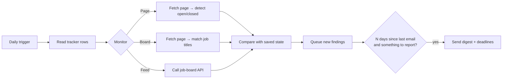

# Job alerts

A Google Sheets application tracker that watches careers pages and job boards for you and sends a short digest email when something changes: a programme opens, a new role matching your level is posted, or a deadline is coming up.

It runs entirely inside your own Google account using Apps Script. There is no server, no API key and no cost.

## What it does

Every morning it reads each row of your tracker and, depending on that row's **Monitor** setting:

| Monitor | What it watches | You are told when |
|---|---|---|
| `Page` | A programme's page (e.g. a graduate scheme) | The page switches from closed / "register interest" to open, or its application wording changes |
| `Board` | A careers or jobs listing page | A new listing appears whose title matches your keywords |
| `Feed` | A Greenhouse, Lever, Ashby or Workable job board, read through its public API | A new matching job is posted (the most reliable mode) |
| `Native alert` / `Off` | Nothing | — |

Findings are saved up and sent as one digest **at most every N days** (default 3), and only when there is something to report. Each digest also lists confirmed deadlines and expected opening dates in the next 10 days. Setting a row's Status to *Applied*, *Rejected* and so on stops tracking it.

The first run records a baseline, so you are not alerted about things that were already there.



## Setup

### 1. Create the spreadsheet

Upload `template/tracker_template.xlsx` to Google Drive and choose **File → Save as Google Sheets**. You can also use your own tracker, as long as it has the columns below and a `Settings` tab copied from the template.

Columns the script reads (any order, matched by header name):

`Role / Programme` (or `Board`) · `Organisation` · `Link` · `Status` · `Opens (date)` · `Deadline (date)` · `Monitor` · `Feed`

It writes to `Last checked` and `Detected state` if those columns exist.

### 2. Add the script

**Option A: copy and paste (simplest).** In the Google Sheet open **Extensions → Apps Script**, replace the contents of `Code.gs` with [`dist/Code.gs`](dist/Code.gs), and save. Then open **Project Settings**, tick *Show "appsscript.json" manifest file*, and replace that file with [`src/appsscript.json`](src/appsscript.json). This narrows the permissions the script asks for.

**Option B: [clasp](https://github.com/google/clasp)** (if you want to edit locally and keep the repo in sync):

```bash
npm install -g @google/clasp
clasp login
cp .clasp.json.example .clasp.json   # paste your Script ID from Apps Script → Project Settings
npm run push                         # bundles and uploads src/
```

### 3. Turn it on

Reload the spreadsheet. A **Job alerts** menu appears. Click **Install daily schedule** and approve the permission prompt. Google shows an "unverified app" warning because this is your own script: choose **Advanced → Go to project**.

To preview an email, use **Job alerts → Send a test digest now**.

## Settings

Everything is configured on the `Settings` tab:

| Setting | Default |
|---|---|
| Send emails to | the Google account running the script |
| Email at most every (days) | 3 |
| Deadline reminder window (days) | 10 |
| Job keywords (any) | intern, graduate, researcher, economist, analyst, fellowship, … |
| Exclude if title contains | senior, head of, director, manager, … |
| Statuses to stop tracking | Applied, Interview, Offer, Rejected, Not applying, … |

Keyword matching uses whole words, so `intern` does not match "International".

## How detection works

- **Pages** are stripped of scripts, navigation and footers, then split into lines. A line like "Applications are now open" or "Applications close on 12 March" is a strong open signal. "Register your interest", "applications have closed" or "no current vacancies" count as closed. An alert fires on a transition to open, so a page that always says "Apply now" does not trigger repeatedly.
- **Boards and feeds** store a short hash of every listing seen. Anything new that matches your keywords is reported. Hashes are kept even when a listing briefly disappears, so it isn't announced twice.
- **State** lives in two hidden tabs, `_state` and `_queue`, in your spreadsheet.

## Permissions

`src/appsscript.json` limits the script to:

| Scope | Why |
|---|---|
| `spreadsheets.currentonly` | read and update this one spreadsheet, not your other files |
| `script.container.ui` | add the Job alerts menu |
| `script.external_request` | fetch careers pages and job-board APIs |
| `script.send_mail` | email the digest to you |
| `script.scriptapp` | create the daily trigger |
| `userinfo.email` | find your address when "Send emails to" is blank |

## Limitations

- Some careers sites build their pages with JavaScript or block automated requests. After three failed checks in a row, the digest lists them under "Could not read". Use their own email alerts instead (set Monitor to `Native alert`).
- Page-change detection can be noisy for a week or so on busy pages. Switching a noisy row from `Page` to `Board`, or adding exclusions, usually fixes it.
- Apps Script quotas (consumer accounts): 100 emails/day and 20,000 URL fetches/day. This uses a tiny fraction of both.

## Development

```bash
npm test          # unit tests for parsing + an end-to-end run against fake Google services
npm run bundle    # rebuild dist/Code.gs from src/
```

`src/Parse.js` has no Google dependencies, so it is tested directly in Node. `test/smoke.test.js` runs the whole script against in-memory fakes of SpreadsheetApp, UrlFetchApp and MailApp: a baseline run, then a page opening, a new board listing and a new feed job, then exactly one digest email. GitHub Actions runs both on every push and checks that `dist/Code.gs` is up to date.

```
src/
  Main.js        menu, trigger, settings, daily check
  Parse.js       HTML → lines, open/closed detection, keyword matching, job-board APIs
  Storage.js     hidden state and queue tabs
  Digest.js      the email
  appsscript.json
dist/Code.gs     single-file build for copy-paste setup
template/        blank tracker with one example row
test/            node:test suites
```

## Privacy

Your tracker, notes and email address stay in your Google account. The repository contains only code and an empty template; `.gitignore` excludes `.xlsx`/`.csv` files outside `template/` and your `.clasp.json`.

## License

MIT
